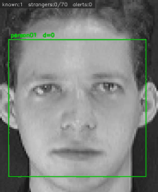
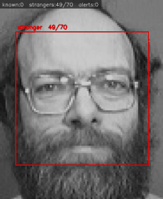

# 基于 OpenCV 的人脸识别系统

用 Haar 级联检测人脸，LBPH 做识别，再对陌生人累计报警。不用深度学习框架，CPU 就能跑。





两张动图分别对应"认出登记过的人"和"陌生人累计到阈值后触发报警"，
截自 `samples/` 里的两段演示视频。素材来自 ORL 公开数据集。
动图是 `recognize.py --save` 导出的视频转的，跟实际跑出来的画面一致。

## 判定逻辑

系统只认识登记过的人，名单外的都算陌生人。每检测到一次陌生人，计数加一；
累计到阈值就发短信报警。识别出已知人员时计数清零。

计数用的是次数，不是连续帧数。区别在这里：按连续帧算的话，有人反复快速
从镜头前经过就能把计数冲掉、躲开报警。

哪些身份算"名单内"，由 `src/config.py` 里的 `HOLDOUT_SUBJECTS` 决定，
不在里面的不参与训练。这同时也是机器学习里的 holdout 做法——留一部分数据
不训练，看模型对没见过的输入是什么反应。

运行时画面顶部有一条状态栏，显示已知识别数、陌生人当前计数、已报警次数。

## 跑起来

```bash
pip install -r requirements.txt

# 训练（仓库自带 ORL 数据集，40 人 × 10 张，直接能跑）
python train.py

# 识别登记过的人
python recognize.py

# 看陌生人累计和报警
python recognize.py samples/demo_stranger.avi

# 用摄像头（最直观）
python recognize.py 0
```

`recognize.py` 还有几个参数：`--save 文件` 把带标注的结果存成视频，
`--hold` 播放完保持最后一帧，`--no-display` 不弹窗只看统计。

装依赖时要用 `opencv-contrib-python`，不是 `opencv-python`。
`cv2.face.LBPHFaceRecognizer_create` 只在 contrib 版里有，
装错会报 `module 'cv2' has no attribute 'face'`。

## 目录结构

```
.
├── train.py                    # 训练入口
├── recognize.py                # 识别入口（含陌生人报警）
│
├── src/                        # 两个入口共同导入的模块
│   ├── config.py               # 训练与推理必须共用的配置
│   ├── detector.py             # Haar 级联的加载 / 检测 / 裁片
│   ├── dataset.py              # 扫描 data/、解析标签
│   ├── recognizer.py           # LBPH 的训练 / 保存 / 加载 / 预测
│   └── alarm.py                # 短信报警（凭据走环境变量）
│
├── tutorials/                  # 学习用的脚本，独立可跑，不依赖 src
│   ├── 01_image_basics.py      # 读图、灰度、缩放、绘制
│   ├── 02_face_detection.py    # 单张 / 多人脸检测
│   ├── 03_video_detection.py   # 视频逐帧检测
│   └── 04_face_capture.py      # 从摄像头采集训练素材
│
├── data/                       # ORL 数据集 + 命名规则说明
├── samples/                    # 演示素材
│   ├── demo.avi                #   登记过的 8 个人
│   ├── demo_stranger.avi       #   5 个名单外的人
│   ├── sample_face.jpg
│   └── group_faces.jpg
├── screenshots/                # README 里引用的动图
└── trainer/                    # 训练产物，不入库
```

`src/` 里这几个模块是被 `train.py` 和 `recognize.py` 同时导入的，所以单独放一层。
`tutorials/` 下面的脚本刻意不依赖 `src/`，方便单独复制出去跑。

## 参数为什么要集中放

`train.py` 训练出 `trainer/trainer.yml`，`recognize.py` 再读它——两个脚本
之间是靠文件耦合的，不是函数调用。

这样一来，如果两边对"人脸长什么样"的假设不一致，程序不会报错，但结果会变差。
比如训练时把人脸裁成 100×100 存进模型、推理时裁成 80×80 去比对：代码照跑，
LBPH 的网格特征却全对不上，识别率直接崩掉，而且从报错信息里看不出线索。

所以两边必须一致的东西都集中在 `src/config.py`：`FACE_SIZE`（裁片尺寸）、
`CASCADE_FILE`（级联文件）、`DETECT_PARAMS`（检测参数）、`UNKNOWN_THRESHOLD`
（判定阈值），以及模型和标签的保存路径。改一处两边同时生效。

## 实测结果

下面这些数都是在本仓库的数据上跑出来的。

**演示视频。** `demo.avi` 里是登记过的 8 个人，160 次检测全部识别为已知，
没有报警；`demo_stranger.avi` 里是 5 个名单外的人，150 次检测全部判为陌生人，
触发报警 2 次。

**真实场景下的泛化。** 上面 160 / 0 这么干净，是因为演示视频用的就是登记照本身，
距离恒为 0。真实场景里摄像头拍到的是另一张照片，距离会大得多。用每人前 5 张
登记、同一人的后 5 张当熟人、另外 5 个没登记的人当陌生人，测出来是这样：

| 类别 | 样本数 | 平均距离 | 距离范围 |
|---|---|---|---|
| 熟人（同一人、不同照片）| 136 | 66.2 | 50.0 ~ 90.5 |
| 陌生人（从没登记过）| 43 | 83.4 | 71.9 ~ 98.0 |

两类分布重叠在 72~91。也就是说，没有任何一个阈值能同时做到"熟人全通过"
和"陌生人全拦住"。只能权衡：

| 阈值 | 熟人通过率 | 陌生人被放行 |
|---|---|---|
| 60 | 27.2% | 0% |
| **74（本项目用这个）** | **约 79%** | **约 5%** |
| 80 | 89.7% | 37.2% |
| 100 | 100% | 100% |

取 74 是因为预警场景里"陌生人被放行"比"熟人被误拒"严重得多，所以宁可偏严格。
这个数不是拍脑袋定的，就是从上面这张表里选出来的。

**换算法能不能解决。** 在同一份数据上试了几种 `opencv-contrib` 自带的方法，
指标是"陌生人放行率不超过 5% 时，熟人通过率有多高"：

| 算法 | 熟人通过率 |
|---|---|
| LBPH 8×8（本项目用这个）| 78.7% |
| LBPH 16×16 | 70.6% |
| Fisherfaces | 69.1% |
| Eigenfaces | 59.6% |

LBPH 已经是这几种里最好的，换成 Fisherfaces 或 Eigenfaces 反而更差。
要真正跨过这个重叠，得换成深度嵌入（FaceNet、ArcFace 这一类），
用度量学习把同一个人的特征拉近、不同人推远。

## 阈值怎么调

`src/config.py` 里的 `UNKNOWN_THRESHOLD` 默认是 74，这个值随下面这些因素变化很大：

| 因素 | 影响 |
|---|---|
| 人脸在画面中的大小 | 与训练尺度差得越多，距离越大 |
| 背景 | 换背景会改变检测框大小，进而改变裁片内容 |
| 视频压缩 | 有损编码（mp4v / H.264）能让人脸距离整体抬高 20~60 |
| 光照 | 本文数据集背景偏暗，换环境要重新评估 |

换成自己的数据时这个阈值必须重新标定：

```bash
# 跑的时候指定画面里真实的人是谁，观察输出的距离分布
python recognize.py 视频 --truth <姓名>
```

调的时候记住那个取舍：阈值调小，陌生人更难混进来，但熟人也更容易被误拒。

## 短信报警配置（可选）

账号密码没有写在代码里，要走环境变量：

```bash
# Windows（只对当前终端有效）
set SMS_USER=你的账号
set SMS_PASSWORD=你的密码
set SMS_PHONE=接收报警的手机号
```

也可以复制 `.env.example` 成 `.env` 填进去（`.env` 已经在 `.gitignore` 里排除了）。
不配置也能正常跑，只是检测到陌生人时只打印、不发短信。

账号密码不要写进 `.py` 再提交。一旦进了 Git 历史，事后删掉也还能翻出来。

## tutorials 里的四个脚本

按难度递进，都能单独跑：

| 脚本 | 内容 |
|---|---|
| `01_image_basics.py` | 读图、灰度、缩放、绘制图形 |
| `02_face_detection.py` | 检测单张人脸和多人合影 |
| `03_video_detection.py` | 视频逐帧检测 |
| `04_face_capture.py` | 从摄像头采集自己的训练素材 |

跑完这一圈，大致就能看懂 `train.py` 和 `recognize.py` 里每一步在做什么。

## 常见问题

**跑 `python recognize.py` 怎么好像只有结果、看不到过程？**

早先有两处问题，现在都改了。一是演示视频原本只有 6.4 秒，窗口一闪就过去；
二是播放速度没按源帧率走——原来写死 `waitKey(10)`，但人脸检测本身要 20~40 毫秒，
等于把视频快放了一倍多，窗口实际只存活两三秒。现在按源帧率算每帧延时，
演示视频也加长到了 16 秒。

要是还觉得太快，用摄像头跑（`python recognize.py 0`），或者 `--save` 存成视频慢慢看，
或者加 `--hold` 让播放完不关窗。

另外 OpenCV 的窗口有时会出现在 IDE 窗口后面，在 PyCharm 里跑完没看到的话，
先看看任务栏有没有多出一个窗口。

## 已知限制

熟人和陌生人的距离分布会重叠（实测重叠区 72~91），所以误判没法完全消除，
只能选择偏严还是偏松。本项目选了偏严的一侧。

换更复杂的经典算法也没用，上面测过一轮，LBPH 已经是最好的。
真要跨过去得上深度嵌入。

LBPH 对成像条件敏感，人脸尺度、背景、光照、视频编码都会明显抬高距离，
所以演示视频用了无损编码和原始尺度。

Haar 级联对侧脸、遮挡、大角度旋转的检出率会下降，也没做活体检测，
对着照片也可能通过，不能用在门禁这类场景。

所有评测都是在 ORL 数据集内部做的，换成真实监控场景会更难。

## 数据集

用的是 ORL / AT&T Database of Faces（也叫 Olivetti Faces）：

- 40 位被试，每人 10 张，共 400 张
- 92 × 112 像素，8 位灰度
- 1992–1994 年采集，同一个人的 10 张在光照、表情、有没有戴眼镜上有差异

原始数据来自 [AT&T Laboratories Cambridge](https://www.cl.cam.ac.uk/research/dtg/attarchive/facedatabase.html)，
本仓库转成了 JPG 并重命名。文件名点号前面的数字就是训练标签，
细节写在 [`data/README.md`](data/README.md)。

`src/config.py` 里的 `HOLDOUT_SUBJECTS`（默认 36~40 号）不参与训练，
在预警系统里扮演陌生人。所以本仓库实际只训练了 35 个身份。
想让模型认识全部 40 人，把这个集合改成空的再重训就行。

换成自己的人脸：图片放进 `data/`，命名成 `1.任意名.jpg`、`2.任意名.jpg`
（同一个人的所有图片用同一个数字），然后重跑 `python train.py`。
也可以直接用 `tutorials/04_face_capture.py` 从摄像头采。

## 参考

- F. Samaria and A. Harter, *Parameterisation of a stochastic model for human face
  identification*, 2nd IEEE Workshop on Applications of Computer Vision, 1994.
- [OpenCV](https://opencv.org/)

## License

[MIT](LICENSE)
