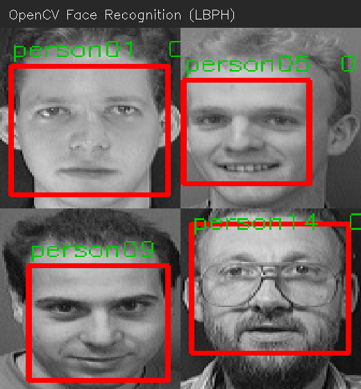

# 基于 OpenCV 的人脸识别系统

一个用 OpenCV 从零实现的完整人脸识别项目：**人脸检测 → LBPH 特征训练 → 实时识别 → 未知人员短信告警**。

不依赖深度学习框架，只用经典的 Haar 级联检测器 + LBPH（局部二值模式直方图）算法，
适合理解人脸识别的完整流程，也可以作为经典算法与深度学习方案对比的基准。



*（图为演示视频中的 4 帧：红框是检测到的人脸，绿字是识别出的标签和置信度。
置信度越小越像，这里都是 0。人脸来自 ORL 公开数据集。）*

---

## 功能

| 功能 | 说明 |
|---|---|
| 人脸检测 | Haar 级联分类器，支持单张图片、多人合影、视频、摄像头 |
| 人脸录入 | 从视频/摄像头逐帧采集人脸样本 |
| 模型训练 | LBPH 算法，把人脸切成网格统计纹理直方图，无需 GPU |
| 人脸识别 | 实时识别并标注姓名，置信度低时判为未知人员 |
| 未知人员告警 | 连续多帧检测到未知人员时发短信（可选功能，见下文） |
| 精度统计 | 在标注视频上统计正确识别率 / 误识别率 / 拒识率 |

---

## 环境要求

```bash
pip install -r requirements.txt
```

**必须装 `opencv-contrib-python`，不是 `opencv-python`。**
`cv2.face.LBPHFaceRecognizer_create` 只存在于 contrib 版本里，
装错会报 `module 'cv2' has no attribute 'face'`。

Python 3.8+ 即可，**不需要 GPU**。

---

## 快速开始

```bash
# 1. 训练模型（仓库自带 ORL 公开数据集，直接跑即可）
python 09数据训练.py
#   -> 生成 trainer/trainer.yml 和 trainer/labels.json

# 2. 识别（默认用自带的演示视频）
python 10人脸识别.py

# 也可以用自己的摄像头
python 10人脸识别.py 0

# 也可以指定自己的视频
python 10人脸识别.py D:\my_video.mp4
```

---

## 项目结构

```
.
├── 01读取图片.py           # 从下面开始是学习路径，循序渐进
├── 02灰度转换.py
├── 03修改尺寸.py
├── 04绘制矩形.py
├── 05人脸检测.py
├── 06检测多个.py
├── 07视频检测.py
├── 08人脸录入.py
├── 09数据训练.py           # 训练 LBPH 模型
├── 10人脸识别.py           # 主程序：检测 + 识别 + 告警
├── config.py               # 训练与推理共用的配置（裁片尺寸、级联文件、检测参数、路径）
│
├── data/                   # 训练数据（ORL/AT&T 公开数据集，40 人 × 10 张）
│   └── README.md           # 数据集来源与命名规则说明
├── trainer/                # 训练产物（模型不入库，由 09 生成）
├── samples/                # 演示素材（单张人脸 / 多人合影 / 演示视频）
├── screenshots/            # 效果截图
│
├── .env.example            # 短信告警配置模板
├── .gitignore
├── requirements.txt
└── LICENSE
```

01–08 是**学习路径**，每个脚本只演示一个概念；09–10 是完整的生产流程。

### 关于 `config.py`

这个项目有个隐蔽的风险：**训练（09）和推理（10）之间是通过"文件"耦合的，不是函数调用。**

如果两边对"人脸长什么样"的假设不一致，**程序不会报错，但结果会悄悄变差**。
比如训练时把人脸裁成 100×100 存进模型、推理时裁成 80×80 去比对——
代码能跑，没有任何报错，但 LBPH 的网格特征全都对不上，识别率直接崩掉，
而且**从报错信息里看不出任何线索**。

所以凡是「两边必须一致」的量，全部集中放在 `config.py`：

| 配置项 | 不一致的后果 |
|---|---|
| `FACE_SIZE` | 裁片尺寸不同 → 特征网格错位，识别率静默崩坏 |
| `CASCADE_FILE` | 训练与推理"找脸"的标准不同 |
| `DETECT_PARAMS` | 同上。其中的 `minNeighbors` 决定检测的严格程度 |
| `TRAINER_PATH` / `LABELS_PATH` | 找不到模型或标签文件 |

改一处，两边同时生效。

> `DETECT_PARAMS` 里的 `minNeighbors` 统一取 **5**（更严格）。理由是推理端面对的是
> 真实摄像头和杂乱背景，用 5 不容易把误检框当成人脸，也避免训练时把误检样本喂进模型。
> 在 ORL 留出集上的代价约 1 个百分点。

---

## 数据集

使用公开数据集 **ORL / AT&T Database of Faces**（又称 Olivetti Faces）：

- 40 位被试，每人 10 张，共 400 张
- 92 × 112 像素 8 位灰度图
- 1992–1994 年采集，同一人的 10 张在光照 / 表情 / 是否戴眼镜上有差异

原始数据来自 [AT&T Laboratories Cambridge](https://www.cl.cam.ac.uk/research/dtg/attarchive/facedatabase.html)，
本仓库已转成 JPG 并重命名。**文件名点号前的数字即训练标签**，
详见 [`data/README.md`](data/README.md)。

> 如果你要换成自己的人脸：把图片放进 `data/`，命名成 `1.任意名.jpg`、`2.任意名.jpg`
> （同一个人的所有图片用同一个数字），然后重跑 `09数据训练.py`。

---

## 实测结果

以下数字都是在本仓库数据上实跑得到的。

### 1. 演示视频端到端（`samples/demo.avi`）

| 指标 | 结果 |
|---|---|
| 人脸检出 | 64 / 64 帧（100%）|
| 正确识别 | **64 / 64（100%）** |
| 平均置信度 | 0.00 |

演示视频用无损编码（FFV1）、人脸保持原始尺度，因此识别结果与训练条件完全一致。

### 2. 留出集泛化测试

用**每人前 5 张训练**，用**后 5 张（模型没见过的照片）测试**：

| 方案 | 标签正确率 | 平均置信度 |
|---|---|---|
| 不做尺寸归一化 | 88.6%（156/176）| 93.0 |
| **加了尺寸归一化**（本仓库采用）| **93.8%（165/176）** | 67.0 |

尺寸归一化（把人脸裁片统一缩放到 100×100）提升明显，因为 LBPH 会把脸切成固定
8×8 网格统计纹理，人脸大小不一致时网格内容会错位。

### 3. 置信度能否区分「认对」和「认错」

| | 样本数 | 平均置信度 | 范围 |
|---|---|---|---|
| 正确匹配 | 165 | 66.1 | 50.0 ~ 90.2 |
| 错误匹配 | 11 | 81.1 | 71.5 ~ 90.5 |

**两个区间是重叠的**（约 71~90 区间内既有认对也有认错）。
这意味着**没有一个阈值能干净地把两类分开** —— 这是 LBPH 这类经典方法的固有限制，
也正是现代人脸识别转向深度嵌入（FaceNet / ArcFace 等）的原因。

---

## 置信度阈值怎么调

`10人脸识别.py` 顶部的 `UNKNOWN_THRESHOLD`（默认 **80**）决定多大差异算「未知人员」。
**LBPH 的置信度是距离，越小越像**，但这个值会随以下因素大幅变化：

| 因素 | 影响 |
|---|---|
| 人脸在画面中的大小 | 与训练尺度差得越多，置信度越高 |
| 背景 | 换背景会改变检测框大小，进而改变裁片内容 |
| 视频压缩 | 有损编码（mp4v / H.264）能让人脸置信度整体抬高 20~60 |
| 光照 | 本文数据集背景光较暗，换环境需重新评估 |

**调法**：用带标注的视频跑 `10人脸识别.py 视频 --truth <姓名>`，
观察输出的置信度分布，再据此设阈值。

---

## 短信告警配置（可选）

程序**不会把账号密码写在代码里**。要启用告警，先设置三个环境变量：

```bash
# Windows（当前终端有效）
set SMS_USER=你的账号
set SMS_PASSWORD=你的密码
set SMS_PHONE=接收告警的手机号
```

或复制 `.env.example` 为 `.env` 后填写（`.env` 已在 `.gitignore` 中排除）。

**不配置也能正常跑**，只是检测到未知人员时只打印、不发短信。

> ⚠️ 不要把账号密码写进 `.py` 文件再提交 —— 一旦进入 Git 历史，
> 事后删掉也仍然能被翻出来。

---

## 已知限制

1. **LBPH 对成像条件敏感**：人脸尺度、背景、光照、视频编码都会显著抬高置信度。
   这也是本项目在演示视频上用无损编码 + 原始尺度的原因。
2. **不是生产级方案**：Haar 级联对侧脸、遮挡、大角度旋转的检出率会明显下降；
   LBPH 的判别力也远不如深度模型。本项目的定位是**理解流程与经典基线**。
3. **验证集是「同一数据集内的留出集」**：93.8% 是 ORL 内部的结果，
   换成真实监控场景表现会下降。
4. **未做活体检测**：对着照片也可能识别通过，不适合门禁等安全场景。

---

## 致谢

- 数据集：The ORL Database of Faces, AT&T Laboratories Cambridge
  （F. Samaria & A. Harter, *Parameterisation of a stochastic model for human face
  identification*, 2nd IEEE Workshop on Applications of Computer Vision, 1994）
- 人脸检测：[OpenCV](https://opencv.org/) Haar 级联分类器

## License

[MIT](LICENSE)
